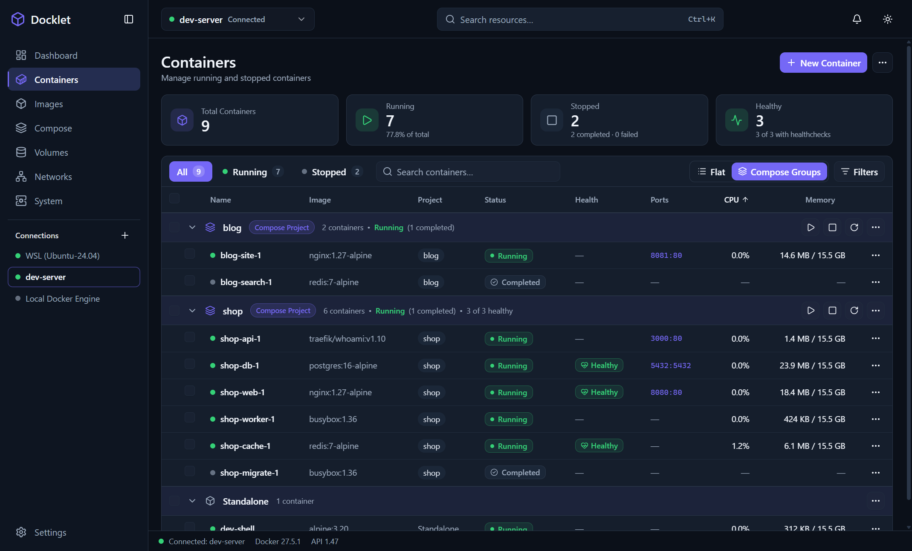
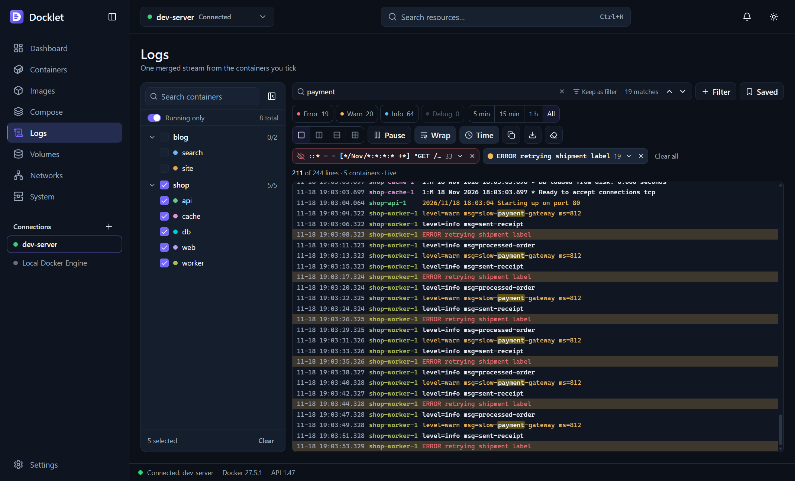
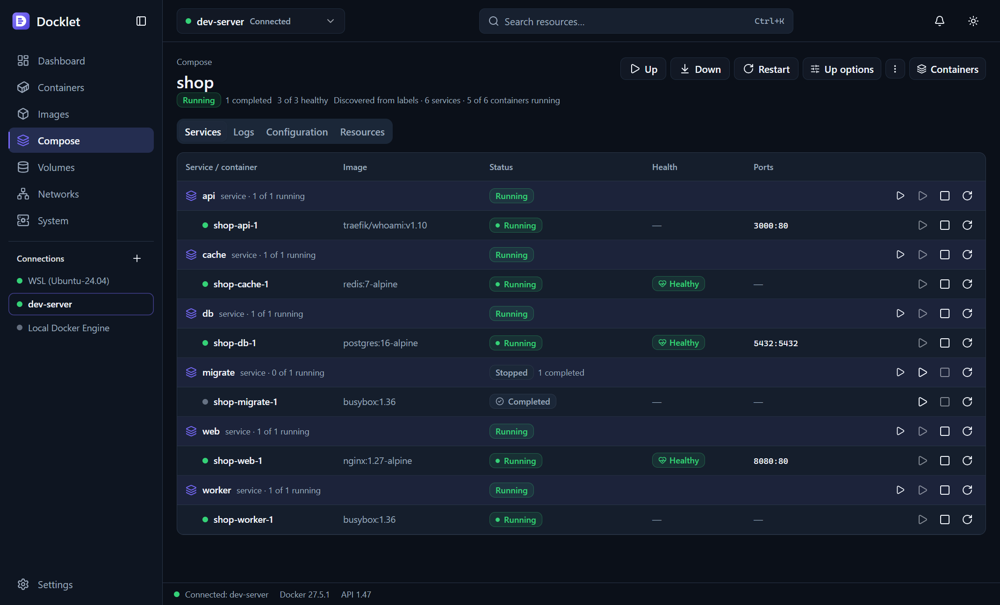

# Docklet

A fast, lightweight desktop app for managing the Docker Engines you already have. No bundled engine, no virtual machine, no account, and no Docker Desktop required.



## Why Docklet

- **Works with your existing Docker.** Connect to Docker in WSL2, a local socket, a remote host over SSH, or TCP with TLS. Switch between engines in one click.
- **Compose is first class.** Containers are grouped by Compose project. Open a compose file from disk and run it, or manage projects that are already running.
- **Everything for daily work in one place.** Logs, a terminal, live stats, a file browser, images, volumes, networks and cleanup.
- **Stays out of your way.** No forced updates, no sign-in, no background services. The tray icon and update check are optional and off by default.

## Features

**Containers**
- Compose-grouped or flat list with search, filters, sorting and bulk actions
- Create, start, stop, restart, pause, kill and remove
- Edit a container's settings and recreate it, with automatic rollback if the new one fails to start
- Live logs with search, and stackable include, exclude and highlight filters (wildcards and regex)
- One Logs screen for several containers or whole projects at once, merged or in up to four panes
- Copy a container as a `docker run` command, a Compose service or a database connection string
- Built-in terminal, or open your own; a debug shell for containers that have none
- Port check before you create: see which program or container already holds a port
- Live CPU and memory, processes, and a file browser that also works on stopped containers
- Published ports open in your browser

**Compose**
- Up, Down, Start, Stop, Restart, Pull and Build, for a whole project or one service
- Open a compose file from disk and start it right away
- Open the project in your editor or file manager
- CPU, memory and disk use per project

**Images, volumes and networks**
- Pull, build, push, tag, save, load and remove images
- See which build steps make an image large
- See when a newer image is available, then update and recreate in one step
- Create, browse, export and import volumes
- Create networks and connect or disconnect containers
- Sign in to registries, with credentials kept in the OS credential store

**Engines**
- WSL2, named pipe, Unix socket, SSH, TCP with TLS, and Docker CLI contexts
- Disk usage, events, host ports and one-click cleanup with clear confirmations
- On Windows: install Docker Engine in a WSL distribution, see its memory and disk use, reclaim memory or restart it

**App**
- Optional alerts when a container crashes, runs out of memory or turns unhealthy
- Command palette (Ctrl/Cmd+K)
- Dark and light themes, adjustable text size





## Install

Download the latest installer from the [Releases](https://github.com/koderi-dp/docklet/releases) page.

| Platform | File |
|---|---|
| Windows (x64) | `docklet-<version>-windows-amd64-installer.exe` |
| Windows (ARM64) | `docklet-<version>-windows-arm64-installer.exe` |
| Linux (experimental) | `.AppImage` or `.deb` |
| macOS (experimental) | `.zip` |

The installers are not code signed yet, so Windows SmartScreen and macOS Gatekeeper will show a warning the first time.

On Ubuntu 24.04 and newer, use the `.deb`: it installs the AppArmor profile that lets the web view start. The AppImage cannot install one, so run Ubuntu's profile once (`sudo apt install apparmor-profiles`, then `sudo cp /usr/share/apparmor/extra-profiles/bwrap-userns-restrict /etc/apparmor.d/ && sudo apparmor_parser -r /etc/apparmor.d/bwrap-userns-restrict`) or start it with `DOCKLET_DISABLE_WEBKIT_SANDBOX=1`.

Windows is the main platform. Linux and macOS builds are new and have had little real-world use; please open an issue if something does not work.

## Requirements

- A Docker Engine you can reach: for example Docker installed in WSL2, on this machine, or on a server.
- For Compose actions: the Docker CLI with the Compose plugin, on the machine where your compose files live.
- For SSH connections: an OpenSSH client.

## Build from source

You need Go, Node.js and the [Wails v3](https://v3.wails.io) CLI.

```
go install github.com/wailsapp/wails/v3/cmd/wails3@v3.1.0
wails3 dev      # run with hot reload
wails3 build    # build to bin/
```

See [docs/DEVELOPMENT.md](docs/DEVELOPMENT.md) for tests, packaging, releases and the project layout.

## Not included

Docklet is a client, not a runtime. It does not ship a Docker Engine, Kubernetes, Swarm management or an extension marketplace.

## License

[MIT](LICENSE)
